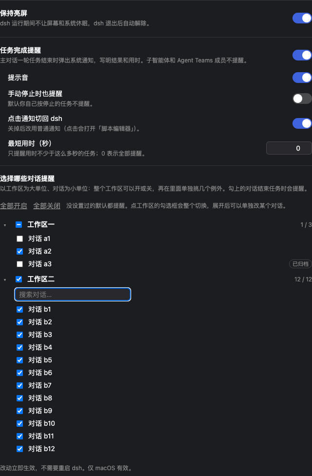

# dsh-small-toolkit

DeepSeek Harness（dsh）的小功能合集。每个功能是 `lib/features/` 下的一个文件，可以分别开关。

## 功能

| 功能 | 配置键 | 作用 |
|---|---|---|
| 保持亮屏 | `keepAwake` | dsh 运行期间阻止 Mac 息屏和休眠（`caffeinate -di -w <dsh 进程>`），dsh 退出后自动解除 |
| 任务完成提醒 | `taskNotify` | 主对话的一轮任务结束时，弹出 macOS 系统通知：对话标题、结果（完成 / 出错 / 被拦截 / 输出达到上限）和用时。**点击通知会切回 DeepSeek Harness 窗口**。子智能体、Agent Teams 成员不提醒；你手动停止的任务默认不提醒 |

两项功能都只在 macOS 上生效。

## 安装

```bash
dsh plugin --profile web add github:HanYu-me/dsh-small-toolkit
# 桌面版：dsh plugin --profile desktop add github:HanYu-me/dsh-small-toolkit
```

装好后重启 dsh。也可以从 [Releases](https://github.com/HanYu-me/dsh-small-toolkit/releases) 下载预构建的 `dsh-small-toolkit.tgz` 安装。

卸载：`dsh plugin --profile web remove dsh-small-toolkit`，然后重启 dsh。

## 设置界面（开关）

装好后在 dsh 的 **插件（Plugins）页**里找到「dsh-small-toolkit」，点进它的小工具行，就有一个设置页：

- **保持亮屏**：一个开关。
- **任务完成提醒**：一个总开关，下面是「提示音」「手动停止时也提醒」「点击通知切回 dsh」「最短用时（秒）」，再下面是**选择哪些对话提醒**（见下）。



### 选择哪些对话提醒

以**工作区为大单位、对话为小单位**，自己决定哪些对话在任务结束时提醒：

- **整个工作区开 / 关**：点工作区前面的勾选框，整个切换（同时清掉它里面单独设置过的对话）。
- **关掉整个工作区，只选其中几个**：先把工作区关掉，再展开它，勾上要提醒的几个对话。
- **打开整个工作区，不选其中几个**：保持工作区打开，展开后取消勾选不想提醒的对话。
- 工作区勾选框里的「−」表示里面只有一部分对话在提醒；旁边的 `3 / 12` 是「提醒中 / 总数」。
- 没设置过的工作区和对话**默认都提醒**，之后新开的对话跟随所在工作区。
- 「全部开启 / 全部关闭」一键切换所有工作区。对话多时展开后有搜索框；已归档的对话带「已归档」标记。

这些选择保存在 `~/Library/Application Support/dsh-small-toolkit/notify-rules.json`（设置页自动读写，一般不用手改）。「任务完成提醒」总开关关掉时，这里的选择整体不起作用。

所有改动**立即生效，不用重启 dsh**：任务完成提醒在下一次任务结束时读取设置；保持亮屏每 3 秒读取一次，关掉会立刻释放防休眠，重新打开则再次接管。设置写进 profile 的配置里，重启后保持。

> 0.3.0 的 `settings.json` 手动开关已经取消，由这个设置页取代。

## 在配置文件里设置（可选）

设置页写的就是 profile 的 `cordis.patch.yml`，你也可以直接改：

```yaml
- id: small-toolkit
  config:
    keepAwake:
      enabled: true
    taskNotify:
      enabled: true
      notifyOnAborted: false      # true：手动停止的任务也提醒
      sound: true                 # false 为静音
      minDurationSec: 0           # 例如 30：只提醒用时 30 秒以上的任务
      clickOpensApp: true         # 关掉后改回普通通知（点击会打开脚本编辑器）
      notifyOn: [completed, error, blocked, max-tokens]   # 哪些结束方式要提醒；改这一项需重启
      appBundleId: com.deepseek.dsh                        # 点击通知时切到的应用；改这一项需重启
```

除 `notifyOn` 和 `appBundleId` 外，其余字段都可以在设置页里改，立即生效。

## 关于通知

- 通知通过一个随插件自动构建的小助手 App 发出，名字叫「DSH 提醒」、图标是 DeepSeek Harness 的鲸鱼，安装在 `~/Applications/DSHNotifier.app`。**点击通知会把 DeepSeek Harness 切到前台**；如果 DSH 已经退出，则会重新打开它。
- 第一次发通知时，macOS 会问一次「"DSH 提醒"想要发送通知」，点「允许」即可；之后不会再问。也可以在「系统设置 → 通知 → DSH 提醒」里调整样式或关闭。
- 构建助手需要 Swift 工具链（安装 Xcode Command Line Tools 即可，`xcrun -f swiftc` 能用就行）。没有工具链时插件会自动退回普通通知：仍然会提醒，但点击它会打开「脚本编辑器」，而不是 DSH。日志在 `~/Library/Application Support/dsh-small-toolkit/notifier.log`。
- 开启「专注模式」时通知会被静默。

## 添加新功能

1. 在 `lib/features/` 新建一个文件，导出 `id`、`defaults`（至少 `{ enabled: true }`）和 `apply(ctx, config, deps)`；运行时用 `plain(config)`（`lib/live.js`）读设置，这样设置页的改动立即可见。
2. 在 `lib/index.js` 的 `features` 列表里加上它，在 `lib/config.js` 的 Config 里加上字段（要在设置页里改的字段加 `.volatile()`），在 `src/client/index.jsx` 里加上控件。
3. `npm test`、`node scripts/build-client.mjs && node test/ui.mjs`，然后重启 dsh。

## 许可

[MIT](./LICENSE) © Yu Han
